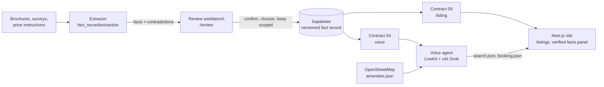

<h1 align="center">🏠 Verified Fact Record: <em>every property fact, with its receipt</em></h1>

<p align="center">
  <b>Drop in the brochures. Get one verified record per home, a listing that never shows a disputed number, and a Grok voice agent that cites the page.</b><br>
  <sub>Grok Bot Real Estate Hackathon · London · Track 2: Documents · built 12 November 2026</sub>
</p>

<p align="center">
  <a href="https://www.youtube.com/watch?v=clWr3SJiLjw"></a>
</p>

<p align="center">
  
  
  
  
  
  
  
</p>

<a id="-demo-video"></a>

## 🎬 Demo video

<p align="center">
  <a href="https://www.youtube.com/watch?v=clWr3SJiLjw" title="Watch the Verified Fact Record demo on YouTube">
    
  </a>
  <br><b>▶️ <a href="https://www.youtube.com/watch?v=clWr3SJiLjw">Watch the demo on YouTube</a></b>
</p>

| 📄 Reads the documents | ⚖️ Catches the contradictions | 🎙️ Speaks only what is verified |
|---|---|---|
| Brochures, surveys and price instructions become facts, each with document, page, verbatim quote, date and issuer | Price changes, area errors, scope and basis differences and official-record mismatches are flagged and sent to a human, never silently picked | The site and the Grok voice agent publish verified facts only, cite the source when asked, and use safe wording for anything still disputed |

> **One-paragraph description.** Property facts disagree. The April brochure for Kelso Villa says £700,000 and prints 185 sq m as 2,700 sq ft; the October brochure says £600,000; the measured survey says the net area is 1,912 sq ft and that bay six is a bin store, not a parking space. Portals and chatbots repeat whichever number they saw first. **Verified Fact Record** extracts every fact with its receipt, classifies each disagreement, lets a reviewer confirm or hold it in a workbench, and publishes one versioned record per unit to Supabase. A buyer-facing site shows only verified values ("Pending verification" otherwise), and a voice agent built on xAI Grok answers from the same record, cites the document and page, books viewings, reserves units, and helps callers find homes near supermarkets, parks and stations on a live map.

<details open>
<summary><b>📑 Contents</b> (click to collapse)</summary>

| | |
|---|---|
| 🎬 [Demo video](#-demo-video) | 🏗️ [Architecture](#️-architecture) |
| 🚀 [The MVP](#-the-mvp) · 🤯 [Wow factors](#-wow-factors) | |
| 🧭 [Judges: a 2-minute tour](#-judges-a-2-minute-tour) | 📊 [Measured results](#-measured-results) |
| 🎯 [The problem](#-the-problem) | 🏆 [How it meets the judging criteria](#-how-it-meets-the-judging-criteria) |
| 📚 [The demo documents and contradictions](#-the-demo-documents-and-contradictions) | 🙏 [Team, credits and data](#-team-credits-and-data) |
| ⚙️ [How it works](#️-how-it-works) | 🛠️ [Run it yourself](#️-run-it-yourself) |
| 🎙️ [The voice agent](#️-the-voice-agent) | 🚧 [Known limits](#-known-limits) |

</details>

---

## 🚀 The MVP

One loop, working end to end on real and synthetic documents:

| Step | What happens | Where |
|:---:|---|---|
| **1. Upload** | Drop one or more PDFs, JSON, ZIP, CSV or text files. Scanned brochures are read with OCR in the browser or by the extraction service | Review workbench (`/review`) |
| **2. Extract** | Every fact carries document, page, verbatim quote, date, issuer and authority tier | `fact_record/extraction` |
| **3. Reconcile** | Disagreements are classified (supersession, true conflict, document error, scope, basis, official record) with a recommended winner and a reason | Review workbench |
| **4. Review** | A human confirms, chooses another source, or keeps both scoped. Nothing material is auto-published | Review workbench |
| **5. Publish** | One versioned record per unit in Supabase (append-only evidence and audit), mirrored as JSON contracts 04 (voice) and 05 (listing) | `supabase/`, `fact_record/contracts` |
| **6. Use** | The listing site shows verified values with citations; the voice agent speaks only verified statements and books or reserves | `client/`, `src/` |

---

## 🤯 Wow factors

| | |
|---|---|
| 🛑 **It refuses to say a disputed number** | Ask the Kelso Villa agent *"How many parking spaces?"* and it says *"The parking allocation is being confirmed"*, because the brochures say six and the survey says five. Even when a stray parking statement slipped into the published contract, the agent drops it. |
| 🧾 **It shows its receipt** | Ask *"What's the asking price and where does that come from?"* and it answers *"£600,000, per the Carter Jonas particulars dated 16 October 2026, page 2."* The property page shows the same quote. |
| 🔎 **It catches the brochure's own mistake** | The April brochure prints 185 sq m beside 2,700 sq ft. 185 sq m is 1,991 sq ft, so the row is flagged as a document error, not treated as two areas. |
| 🗺️ **It finds homes by what is nearby** | Say *"Which flats are closest to a supermarket?"* The agent ranks every listing against 79 supermarkets, 126 parks, 63 stations and more from OpenStreetMap, pins the shortlist on a live map, and opens the home it is talking about on your screen. |
| 📅 **It closes the loop** | It books viewings and records holding reservations by voice, without ever asking for payment details. Bookings appear on the market dashboard. |
| 🔊 **It sounds like a person** | xAI speech-to-text, Grok and the xAI `ara` voice, with text normalisation so "£2,500 pcm" is read the way an agent would say it. |

---

## 🧭 Judges: a 2-minute tour

| Step | Do this | You'll see |
|:---:|---|---|
| **1** | Open **http://localhost:3000** (see [Run it yourself](#️-run-it-yourself)) | The landing page, featured homes, and three ways in: explore, ask the AI agent, book a viewing |
| **2** | Open **Kelso Villa** | A **Verified facts** panel: price, tenure, areas and EPC each with issuer, document, date, page and quote; parking and sale-or-let show **Pending verification** with their contradiction id |
| **3** | Click **Talk to 24/7 Live Agent** and ask about parking, then the price and its source | The safe wording for parking, and the price with its citation |
| **4** | Go back and press **Start a call** under *Ask the AI agent* | The agent on the left, a map and info panel on the right |
| **5** | Say *"Which flats are closest to a supermarket?"*, then *"Tell me more about the first one"* | Results pinned on the map; the chosen home opens in the panel with its walking time |
| **6** | Say *"I'd like to reserve it"* and give a name and phone number | A reservation confirmation on screen and in `data/sessions/<room>/booking.json` |
| **7** | Open **/review** | The review workbench with the nine demo comparisons: compare two source quotes, then confirm or hold |

---

## 🎯 The problem

### The same home has several "facts", and the listing only shows one

A property is described by a brochure, then a newer brochure, a measured survey, a vendor's price instruction, a developer's schedule of finishes and the official EPC register. They disagree, often for good reasons: a price was cut, a brochure measured gross instead of net, a development-wide spec does not apply to every plot. Today a person reconciles them by eye, or nobody does, and the portal or the chatbot repeats whichever number it saw first.

### Who it is for

- 🏢 **Sales and lettings agencies** who need one defensible record per unit before it goes live.
- 📞 **Buyers and renters** who want a straight answer at any hour, and a source they can check.
- ⚖️ **Compliance teams**: material information (price, tenure, area, parking, EPC) must not mislead.

### What people do today

| Option | Good at | Falls short |
|---|---|---|
| Copy the latest brochure to the portal | Fast | Inherits its mistakes; older claims stay live elsewhere |
| A negotiator checks by eye | Judgement | Slow, no audit trail, not repeatable |
| A generic AI chatbot on the listing | Always on | Picks one number, cannot say which document it came from, invents when unsure |
| **Verified Fact Record** | **Every fact with a receipt, conflicts held for a human, a voice agent that cites** | See [Known limits](#-known-limits) |

---

## 📚 The demo documents and contradictions

Five documents across two developments (`fact_record/sample_data`): the real Carter Jonas and Strutt & Parker brochures, plus synthetic documents marked `synthetic: true` with a "Demo document" footer.

| Development | Documents | What disagrees |
|---|---|---|
| **Kelso Villa** | April 2026 To Let particulars, October 2026 For Sale particulars (both scanned), measured survey (Sept 2026) | Price £700k → £600k; 185 sq m printed as 2,700 sq ft; net area 1,990 vs 1,912 sq ft; gross 2,700 vs 2,672 sq ft; parking 6 vs 5; EPC B in marketing vs C on the register |
| **59 St Huberts Close** | Strutt & Parker brochure, vendor price instruction (Nov 2026), developer schedule of finishes | Guide £1,458,000 → £1,395,000; "all en-suites have walk-in showers" (development) vs a principal en-suite bathroom (No. 59); type D plot facts must not merge into No. 59 (type E) |

The answer key (`contradictions.json`) holds **11 contradictions covering 6 of 7 types**: version supersession, true conflict, unit or measurement mismatch, scope difference, plot or type variation, and official record mismatch. Each has the evidence (document, page, value, verbatim quote), the expected resolution, and what the voice agent should say.

---

## ⚙️ How it works

### 1. Extract every fact with its receipt

The extractor (`python -m extraction run`) reads text layers, OCRs scanned pages, decodes text that was shifted in the PDF, and emits facts with document, page, quote, date, issuer and authority tier. The workbench can also extract in the browser (pdf.js text layer plus tesseract.js OCR) when the service is not running.

### 2. Classify the disagreement, recommend, never decide alone

Source tier beats recency; date breaks ties within a tier. A later formal price instruction can replace a brochure. Safe scope and basis differences are kept side by side automatically. True conflicts, document errors and price changes always go to a human.

### 3. Publish one record, two shapes

Reviewed facts go to Supabase in one transaction: append-only evidence and audit events, versioned accepted facts (`current_property_facts`), scoped claims and open exceptions. The same record is exported as contract **05** (listing: each field verified, pending or not stated, with citation) and contract **04** (voice: statements the agent may say, plus `do_not_state` with safe phrasing).

### 4. Show and speak only what is verified

The site reads contract 05 (and Supabase when configured). The voice agent reads contract 04 (and Supabase when configured), drops any statement whose field is still disputed, and is told to quote only verified facts and cite them when asked.

---

## 🎙️ The voice agent

Built on **LiveKit Agents** with **xAI** for all three stages: xAI speech-to-text, **Grok** (`grok-4.20-0309-non-reasoning` through xAI's chat-completions endpoint) and xAI text-to-speech (voice `ara`). Silero detects the end of each turn.

| Mode | Started from | It can |
|---|---|---|
| 🏠 **One property** | *Talk* on any listing | Answer from that listing (verified facts only for verified listings), describe the floor plan and photos, book a viewing, reserve the unit, capture contact details, save a call summary |
| 🗺️ **General search** | *Start a call* on the landing page, or `/call/general` | Rank all listings by distance to a supermarket, park, station, school, gym, pharmacy, café, restaurant, pub or doctor, filter by budget and bedrooms, open a home on the map, then book or reserve it |

| Tool | What it does |
|---|---|
| `find_properties_near` | Ranks listings by straight-line distance to the nearest amenity, with an approximate walking time |
| `show_property` | Opens a listing on the caller's map and info panel, and loads its details |
| `book_viewing` | Books a viewing for the current listing, or any listing by id |
| `reserve_unit` | Records a holding reservation (name, contact, move-in date); the lettings team confirms |
| `capture_customer_details`, `save_call_details` | Save contact details, summary and transcript to `data/sessions/<room>/` |
| `web_search` | Local-area search through Perplexity when `PERPLEXITY_API_KEY` is set |

Map data comes from OpenStreetMap through Nominatim, saved once to `work/amenities.json` by `scripts/fetch_amenities.py`, so a call never waits on a map service.

---

## 🏗️ Architecture



| Part | Tech | Folder |
|---|---|---|
| Extraction pipeline and service | Python, OCR | `fact_record/extraction`, `fact_record/extraction_service` |
| Review workbench | Dependency-free browser app, served by the Next app at `/review` | `conflict-resolution-ui/` |
| Fact store | Supabase (Postgres), migrations and a `published_fact_state` function | `supabase/migrations` |
| Listing site | Next.js 15, Tailwind, LiveKit client | `client/` |
| Voice agent | LiveKit Agents 1.8, xAI STT, Grok, xAI TTS, Silero | `src/` |

---

## 📊 Measured results

What was measured on 12 November 2026, on the running system:

| Check | Result |
|---|---|
| Voice agent asked *"How many parking spaces does Kelso Villa have?"* | Gave the safe wording, no number ✅ |
| Voice agent asked for the price and its source | *"£600,000, per the Carter Jonas particulars dated 2026-10-16, page 2"* ✅ |
| General agent: *"closest to a supermarket"*, *"tell me more about the first one"*, *"reserve it"* | Called `find_properties_near`, then `show_property`, then `reserve_unit`; reservation saved ✅ |
| General agent: *"near a park under £2,500 with two bedrooms"* | Called `find_properties_near` with park, £2,500 and 2 bedrooms ✅ |
| Amenity ranking across all listings | 2–6 ms per query |
| Perceived reply time in a live call (end of speech to first audio) | 1.7–3.5 s |
| Amenity snapshot | 79 supermarkets, 126 parks, 63 stations, 119 schools, 34 gyms, 56 pharmacies, 50 cafés, 50 restaurants, 50 pubs, 23 doctors or hospitals |

The extraction answer key is in `fact_record/sample_data/contradictions.json`. Score an extraction run against it with:

```bash
cd fact_record
python -m extraction all
```

---

## 🏆 How it meets the judging criteria

<table>
<tr><th width="22%">Criterion</th><th>Our case</th></tr>
<tr><td>🎯 <b>Relevance</b></td><td>Track 2 asks for accurate parsing, a citation for every field, and something useful built on top. Every fact carries its document, page and quote, and two products are built on the record: a listing site and a voice agent.</td></tr>
<tr><td>⚙️ <b>Execution</b></td><td>The whole loop runs: extract → reconcile → review → Supabase → site and voice. Real scanned brochures, a typed answer key of 11 contradictions, and a live voice agent with seven tools.</td></tr>
<tr><td>🤖 <b>Effective use of Grok Bot and Cursor</b></td><td>The agent runs on xAI end to end: speech-to-text, Grok for reasoning and tool calls, and the xAI voice. Cursor agents built parts of the review workbench and the extraction upload on their own branches, merged through pull requests (visible in the commit history).</td></tr>
<tr><td>🧾 <b>Traceable data</b></td><td>Document, page, verbatim quote, date, issuer and authority tier on every fact; append-only evidence and audit events in Supabase; the voice agent cites the source on request.</td></tr>
<tr><td>🌍 <b>Practical usefulness</b></td><td>An agency gets one defensible record per unit; a buyer gets a straight, sourced answer at any hour, finds homes by what is nearby, and can book or reserve on the same call.</td></tr>
</table>

---

## 🙏 Team, credits and data

- **Team:** Abhinav Chhabra, Jigar, Siya Ahuja and Anthony Tan (TYK3).
- **AI and platforms:** xAI (Grok, speech-to-text, text-to-speech), LiveKit Agents, Supabase, Perplexity (optional search), and Cursor for building.
- **Documents:** Carter Jonas (Kelso Villa particulars) and Strutt & Parker (59 St Huberts Close particulars). The measured survey, price instruction and schedule of finishes are synthetic and labelled as such.
- **Listings:** Hamptons E14 lettings data in `work/`.
- **Map data:** © OpenStreetMap contributors, available under the Open Database Licence, retrieved through Nominatim.

---

## 🛠️ Run it yourself

**You need:** [uv](https://docs.astral.sh/uv/) with Python 3.12+, [Node.js](https://nodejs.org/) 20+, a LiveKit server (Podman, or the `livekit-server` binary), and an [xAI API key](https://console.x.ai).

**1. Install and configure**

```bash
uv sync
cp .env.example .env
uv run python src/agent.py download-files
cd client && npm install && cp .env.example .env && cd ..
```

Put your key in `.env` as `XAI_API_KEY=`. The LiveKit values are pre-filled for a local dev server.

**2. Start three terminals**

```bash
podman compose up
```

On Windows without Podman, download `livekit-server` from the [LiveKit releases](https://github.com/livekit/livekit/releases) and run `livekit-server --dev --bind 127.0.0.1` instead.

```bash
uv run python src/agent.py dev
```

```bash
cd client && npm run dev
```

Open **http://localhost:3000**. The agent log shows `registered worker` when it is ready.

**3. Optional: the extraction service and Supabase**

```bash
pip install -r fact_record/requirements.txt
python fact_record/extraction_service/server.py
```

Supabase is optional. Without it, the site and agent read the JSON contracts in `fact_record/contracts`. Connect it when you want reviews saved in the workbench to reach the site and the voice agent.

<details>
<summary><b>🗄️ Set up Supabase (about 5 minutes)</b></summary>

1. **Create a project** at [supabase.com](https://supabase.com) (the free tier is enough).
2. **Create the tables.** Open **SQL Editor** in the dashboard and run the two migrations in this order, pasting each file's contents and clicking **Run**:
   1. `supabase/migrations/20261112000000_fact_record.sql`, which creates the tables and the write functions
   2. `supabase/migrations/20261112010000_published_fact_state.sql`, which creates the read function used by the site and agent

   If you use the Supabase CLI, `supabase link` followed by `supabase db push` runs both.
3. **Copy the keys.** In **Project Settings → API**, copy the Project URL, the `anon` public key and the `service_role` secret key.
4. **Put them in the env files:**

   | File | `SUPABASE_URL` | `SUPABASE_ANON_KEY` | `SUPABASE_SERVICE_ROLE_KEY` |
   |---|---|---|---|
   | `.env` (repo root: agent and extraction service) | ✅ | ✅ | ✅ |
   | `client/.env` (website) | ✅ | ✅ | ❌ never |

   The `service_role` key can write to every table, so keep it out of `client/` and out of git. The `anon` key can only read published facts.
5. **Restart** the agent, the site and the extraction service so they pick up the new values.
6. **Check it works:**
   - `curl http://localhost:8765/health` should return `"supabase": true`. This only confirms the keys are set; the sample load below proves the connection.
   - To load the bundled sample review, set `SUPABASE_ALLOW_EXAMPLE=true` in `.env`, then run:
     ```bash
     python fact_record/extraction_service/supabase_sink.py conflict-resolution-ui/examples/database-handoff.example.json
     ```
   - Within about 30 seconds, open `/property/kelso-villa`. The disputed stated floor area shows **Pending verification**, and the reviewed values show their source citation.

After that, the **Save to Supabase** button in the review workbench (`/review`) writes your decisions straight to the database. If Supabase can't be reached, the site and agent fall back to the JSON contracts, so a bad key never takes the demo down.

</details>

**4. Optional: refresh the map data**

```bash
uv run python scripts/fetch_amenities.py
```

<details>
<summary><b>⚙️ Environment variables</b></summary>

| Variable | Used by | Purpose |
|---|---|---|
| `XAI_API_KEY` | agent | xAI speech-to-text, Grok and text-to-speech |
| `XAI_TEXT_MODEL` | agent | Grok model (default `grok-4.20-0309-non-reasoning`) |
| `XAI_VOICE` | agent | Voice (default `ara`; others include `eve`, `sal`, `rex`, `leo`) |
| `LIVEKIT_URL`, `LIVEKIT_API_KEY`, `LIVEKIT_API_SECRET` | agent and site | LiveKit connection (`ws://localhost:7880`, `devkey`, `secret` locally) |
| `AGENT_NAME`, `SESSIONS_DIR` | site | Agent dispatch name (`property-agent`) and session folder (`../data/sessions`) |
| `SUPABASE_URL`, `SUPABASE_ANON_KEY` | agent and site | Read the published fact record |
| `SUPABASE_SERVICE_ROLE_KEY` | extraction service | Write extractions and reviews |
| `SUPABASE_ALLOW_EXAMPLE` | extraction service | Allow the bundled sample datasets to be saved |
| `FACT_LISTING_PATH`, `FACT_VOICE_PATH` | agent and site | Override the paths to contracts 05 and 04 |
| `PERPLEXITY_API_KEY` | agent | Enables `web_search` |
| `PROPERTY_SHOW_FLOORPLAN`, `PROPERTY_SHOW_EPC` | site | Show floor plan and EPC images on property pages |

</details>

<details>
<summary><b>🗺️ Repo map</b></summary>

```
.
├── src/                    # Voice agent (LiveKit + xAI): tools, verified-fact loader, map ranking
├── client/                 # Next.js site: landing, explore, property pages, calls, market, fact checks
├── conflict-resolution-ui/ # Review workbench (served at /review)
├── fact_record/
│   ├── extraction/         # Extractor, contradiction detection, evaluation
│   ├── extraction_service/ # Local HTTP extraction service, Supabase sink
│   ├── contracts/          # 01 extracted → 02 review actions → 03 resolved → 04 voice, 05 listing
│   └── sample_data/        # Demo documents, manifest and the contradictions answer key
├── supabase/migrations/    # Fact record schema and published_fact_state
├── scripts/                # fetch_amenities.py and data helpers
├── work/                   # Hamptons listings and amenities.json
└── data/sessions/          # Per-call bookings, reservations, transcripts (git-ignored)
```

</details>

<details>
<summary><b>🪟 Cloning on Windows</b></summary>

The file `requirements.md ` has a trailing space in its name, which Windows cannot create. After the clone reports "checkout failed", run this in Git Bash inside the repo:

```bash
git -c core.protectNTFS=false read-tree HEAD
git -c core.protectNTFS=false update-index --skip-worktree -- "requirements.md "
git -c core.protectNTFS=false ls-files -z | grep -zv '^requirements.md $' | xargs -0 git checkout HEAD --
```

</details>

---

## 🚧 Known limits

- **Synthetic documents.** Three of the five demo documents are synthetic, and the review workbench's default dataset is a worked scenario. Real uploads replace it.
- **Reviewer identity.** Names and times in the workbench are stored in the browser and are not authenticated.
- **Distances.** Map distances are straight lines, not walking routes, and the budget filter compares numbers only, so a weekly rent passes a monthly limit.
- **EPC.** The official register is not queried directly; the EPC mismatch rests on the survey quoting the register.
- **Local only.** The demo runs on a local LiveKit server; LiveKit Cloud's noise filter and adaptive interruption are switched off there, and Silero handles turn-taking.
